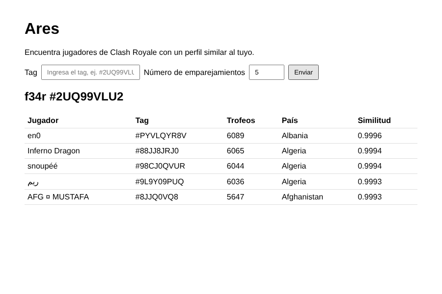

# Proyecto Ares – Clash Royale Player Matchmaking

Web app that recommends **Clash Royale players with a similar profile** to a given player. It uses a nearest-neighbors model (cosine similarity) and is served with Flask.



## How it works

1. **Data** – `players.csv` has 167,233 players: up to the top 1,000 of the local leaderboard of each of 242 countries (2022), with country, rank, experience level, trophies, clan and arena.
2. **Feature engineering** – country and clan are label-encoded and every feature is scaled to [0, 1] with `MinMaxScaler`.
3. **Model** – `NearestNeighbors` with cosine distance (brute force). The similarity shown is `1 - cosine distance`.
4. **Search** – the tag is matched exactly (with or without `#`, any case); if it does not exist, the closest tag is found with fuzzy matching (`thefuzz`).

## Project structure

```
├── app.py               # Model and Flask app
├── players.csv          # Dataset
├── templates/index.html
├── static/style.css
├── images/app.png
├── Procfile             # gunicorn entry point for deployment
├── requirements.txt
└── LICENSE
```

## How to run

```bash
pip install -r requirements.txt
python app.py
```

Then open http://127.0.0.1:5000 and enter a tag, for example `#2UQ99VLU2`.

For production: `gunicorn app:app`.

## Deployment status

The app was originally deployed on Heroku (2022). Heroku [ended its free plan on November 28, 2022](https://www.heroku.com/blog/next-chapter/) and shut down all free apps, so that deployment is no longer online. The `Procfile` is kept so it can be deployed again on any platform that supports it (Heroku, Render, Railway).

## Limitations and next steps

- Country and clan are encoded as integers, so the model treats them as ordered numbers. Better options would be one-hot or target encoding for country and dropping the clan id.
- With cosine distance on features scaled to [0, 1], most similarities are close to 1, so the ranking depends on small differences.
- The data is a 2022 snapshot; it could be refreshed with the official Clash Royale API.

## Author

José Adrián Ochoa Sánchez – [GitHub](https://github.com/Adrian-8a) · [LinkedIn](https://www.linkedin.com/in/adrian-ochoa-ai)
